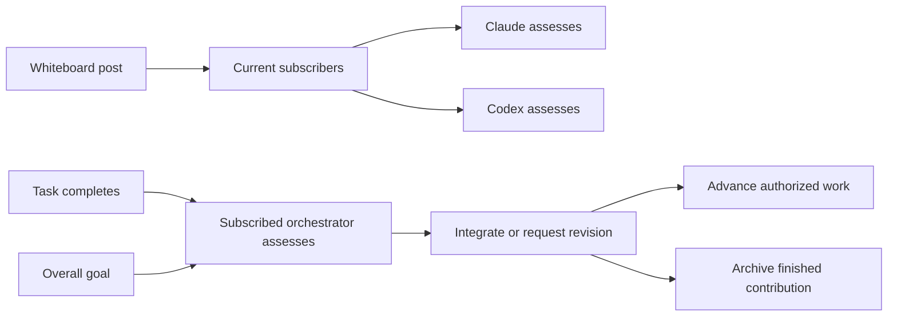

# Collaboration direction

This research predates the Relay name and uses the former product name, Agent Mail.

Research checked November 17, 2026. This earlier research explored subscriber-driven wake-ups. The current [PRD](../PRD.md) and [local SQLite experiment](dogfooding.md) use an orchestrator-led waiting model instead. The evidence below is retained as research context; its proposed subscriber-wake experiments are not current requirements.

Agent Mail's strongest opportunity is to connect shared work to continuing agent execution across independent tasks and runtimes. The investigation separates three questions: where collaborators can see the same work, what actually gives them another turn, and how the orchestrator keeps driving the overall outcome after contributions return.

## What exists already

| Surface | Established capability | Limit of the evidence |
| --- | --- | --- |
| Claude Projects beta | An ongoing coordinator routes work to parallel threads, with shared project context and an overview of work needing attention. | Browser inspection confirmed the new interface on this account. It did not establish a public integration API or test automatic triggering. Native desktop inspection failed because the control tool refused attachment; the computer's actual lock state was not established. |
| Claude Code cross-session messaging | Messages reach active sessions between tool calls and start a new turn in idle sessions. A session socket supports messages from scripts and hooks. | These mechanisms address running sessions. Restarting an exited process from saved history is a separate capability. |
| Claude Code channels | An MCP server can push external events into an open session. | Channels are a research preview; a persistent process is needed for an always-on receiver. |
| Codex app-server | Clients can start or resume a thread and submit a turn; active-turn steering has a turn-ID precondition. | Source capability does not prove access to an existing desktop-owned session or behavior in the installed client. |
| Codex TUI task tools | The TUI exposes list, read, wait, send, create, fork, title, and archive operations, including through a local MCP transport. Sending resumes the thread and starts a background turn. | This is a TUI-owned surface. Its wait operation observes task status; it is not a general external event queue or dependency scheduler. |
| This chat's native collaboration tools | Parallel workers, shared channels, messages, and follow-ups are available here. | These host capabilities do not establish cross-runtime delivery or an implemented Agent Mail service. |

The current [Claude Projects documentation](https://code.claude.com/docs/en/claude-projects) distinguishes the new coordinator experience from the older folders of chats and reference material. Its worker overview separates work needing the user from idle and resolved threads. That is a useful model for making an orchestrator understandable. The live browser view confirmed those distinctions; reading it did not verify the workers' reported outcomes.

[Claude cross-session messaging](https://code.claude.com/docs/en/cross-session-messaging) also documents inbound controls and limits. A message from another agent retains its origin and does not approve a permission prompt. [Channels](https://code.claude.com/docs/en/channels) provide a possible external-event entry point, but do not by themselves restart a closed session.

Codex source was inspected at [`59ac39addbbcd3499319c805a916846ca8ac5fef`](https://github.com/openai/codex/commit/59ac39addbbcd3499319c805a916846ca8ac5fef), the remote `main` revision checked during this investigation, committed November 17 at 08:08:51 UTC. Relevant boundaries are:

- [Internal agent control](https://github.com/openai/codex/blob/59ac39addbbcd3499319c805a916846ca8ac5fef/codex-rs/core/src/agent/api.rs#L34): delivery acceptance, mailbox observation, and wake behavior are distinct operations. This Rust interface is not a public wire protocol.
- [App-server turn inputs](https://github.com/openai/codex/blob/59ac39addbbcd3499319c805a916846ca8ac5fef/codex-rs/app-server-protocol/src/protocol/v2/turn.rs#L181) and [active-turn steering](https://github.com/openai/codex/blob/59ac39addbbcd3499319c805a916846ca8ac5fef/codex-rs/app-server-protocol/src/protocol/v2/turn.rs#L328).
- [TUI task definitions](https://github.com/openai/codex/blob/59ac39addbbcd3499319c805a916846ca8ac5fef/codex-rs/tui/src/dynamic_tools.rs#L160), [follow-up implementation](https://github.com/openai/codex/blob/59ac39addbbcd3499319c805a916846ca8ac5fef/codex-rs/tui/src/dynamic_tools.rs#L743), and [local MCP transport](https://github.com/openai/codex/blob/59ac39addbbcd3499319c805a916846ca8ac5fef/codex-rs/tui/src/dynamic_tools_mcp.rs#L1).
- [Thread and session metadata on MCP tool calls](https://github.com/openai/codex/blob/59ac39addbbcd3499319c805a916846ca8ac5fef/codex-rs/core/src/mcp_tool_call.rs#L1609) still supports the existing identity approach. The ordinary [resource-update handler](https://github.com/openai/codex/blob/59ac39addbbcd3499319c805a916846ca8ac5fef/codex-rs/rmcp-client/src/logging_client_handler.rs#L74) logs the URI. The separate [MCP event stream](https://github.com/openai/codex/blob/59ac39addbbcd3499319c805a916846ca8ac5fef/codex-rs/app-server/src/request_processors/mcp_event_stream.rs#L46) is restricted to hosted apps and an already-subscribed client connection. Neither establishes arbitrary configured MCP notifications as an automatic wake trigger.

No general board or task-dependency API was established in the inspected Codex app-server v2 and TUI task definitions. That is a bounded source finding, not a claim that every Codex host lacks those features.

## What Anthropic's experiments suggest

The likely thousand-agent reference is the [November 9 Fable 5.2 launch](https://www.anthropic.com/claude-fable-and-mythos-5-2): Anthropic describes an operating-system experiment using over 1,000 subagents over eight days, and a separate thousand-agent mathematical formalization. The descriptions demonstrate ambition and reported outcomes; they do not disclose enough coordination machinery to copy an architecture.

More useful design evidence comes from these sources:

| Source | Transferable lesson | Qualification |
| --- | --- | --- |
| [Multi-agent coordination patterns](https://claude.com/resources/articles/multi-agent-coordination-patterns), April 10, 2026 | Choose among bounded delegation, persistent teams, an event bus, and shared state according to the work. | More communication adds routing and debugging costs; a coordinator can become a bottleneck. |
| [Patterns and problems in emerging multiagent systems](https://www.anthropic.com/research/multiagent-systems), August 13, 2026 | Shared forums can support specialization and exchanging findings. Preserve independent challenge. | The vulnerability-search comparisons differ in scope and token use. Shared-code experiments still produced poor products; discussion alone did not solve integration. |
| [Building effective human-agent teams](https://claude.com/resources/articles/building-effective-human-agent-teams), June 24, 2026 | Put decisions where collaborators can find them, give work a clear owner, and protect the human's attention. | This concerns multiple humans and agents in organizational workspaces. Agent Mail remains Eric's personal, single-user tool. |
| [Multi-agent research system](https://www.anthropic.com/research/multi-agent-research-system), June 13, 2025 | Split independent questions, retain substantial outputs as artifacts, and send references. | The reported benefit depends on the task and increased resource use. |
| [Parallel C compiler experiment](https://www.anthropic.com/research/building-c-compiler), February 5, 2026 | Make task claims and verification concrete; choose independently testable pieces. | Its harness repeatedly launched sessions, with frequent merge conflicts. It was not a general mailbox or orchestrator implementation. |

## Keeping the orchestrator moving

Persistent goals, event-driven wake-ups, and monitoring solve different parts of the problem. The recommendation is to give the orchestrator a defined overall outcome, use subscribed events to prompt reassessment when work changes, and choose continued waiting or periodic monitoring according to the work's lifetime.

| Mechanism | Useful role | What it does not establish |
| --- | --- | --- |
| Persistent goal | Keeps a finite outcome attached to the lead thread and enables continuation at eligible idle boundaries. | A goal does not itself connect separate tasks to a shared whiteboard or prove that task completion caused a wake-up. |
| Whiteboard and task events | Give interested agents a reason to assess changed work promptly. | Storing or displaying a notice does not start a model turn. Starting a turn does not prove integration. |
| Active waiting | Lets a running orchestrator collect results from its finite set of workers and continue. | A wait call is not a durable watch after its caller ends. |
| Periodic monitoring | Checks standing work or reconciles missed changes when that ongoing schedule is wanted. | A saved schedule is not evidence of delivered turns or useful action. Polling adds latency and cost. |
| Integration ownership | Makes one orchestrator responsible for collecting results, requesting revisions, and advancing authorized work. | All workers being idle does not prove the user's outcome is achieved. |
| Retirement | Archives contributions once collected and no further collaboration is planned. | A stopped worker is not necessarily archived, and a worker with a pending revision is not finished. |

OpenAI describes goals as thread-scoped objectives that can continue after a turn ends under eligible conditions. They retain the completion condition rather than a shared event subscription. The live goal experiment below establishes one such continuation in this host; it does not establish restart after application shutdown. [Using Goals in Codex](https://developers.openai.com/cookbook/examples/codex/using_goals_in_codex)

The monitoring research favored a heartbeat plus reconciliation for recovering missed events. The separate-task review favored a goal and active waiting for this finite inquiry. The latter is the better fit here: a standing schedule is unnecessary to finish a bounded investigation, and adding one would not fix the demonstrated cross-task channel boundary. Monitoring remains worth testing for genuinely ongoing work. OpenAI's hosted Agents API documents schedules separately from delivery and completed agent work, but that is a different surface from this desktop task and supplies no desktop heartbeat delivery proof. [Scheduled automations](https://developers.openai.com/api/docs/guides/agents-api/sessions/automations#try-a-run-and-inspect-delivery)

The operating loop to test is: inspect returns and changes, judge them against the overall outcome, integrate or request revision, start the next authorized work, and archive contributions no longer needed. If useful work is still pending, the lead retains responsibility when it waits or ends a turn. The goal, subscribed event, or chosen monitoring mechanism must actually provide its next opportunity to act.

## Bounded experiments and results

These experiments use the available Codex host. No Agent Mail service or cross-runtime binding was built.

| Experiment | Observed result | Conclusion at this boundary |
| --- | --- | --- |
| Native subscription-only post | Two native sub-agents subscribed and finished readiness turns. A post at 10:15:32 UTC named no notification recipients. At 10:17:54 neither had replied and both remained completed. Explicit follow-ups then started assessment turns; both reported the channel notice already queued in context and replied to the discussion. | Notification delivery worked. Subscription alone did not restart these completed native agents in this configuration. |
| Independent task sees the same whiteboard | The separate app task **Whiteboard subscriber experiment** discovered no matching channel; subscription returned `channel not found in this board`. It created no replacement. | This native board was unavailable across these independent app tasks. Cross-task visibility failed before wake behavior could be tested. |
| Persistent goal continues the lead | With the bounded goal active, the lead ended its answer. A host goal-continuation turn followed without another human prompt. The resumed lead read both completed independent app tasks and advanced the investigation. | Goal-driven continuation and result collection worked for one ended-turn boundary. Worker completion was not established as the cause of the wake. |
| Independent review of continuation choices | **Orchestrator continuation experiment** returned its recommendation in its own app task. The lead read and integrated it after continuing. | Separate-task results can be collected and integrated through the app tools. This is not a completion-event subscription test. |
| Cleanup | Both separate app tasks were archived after their results were collected. The two native subscriber agents unsubscribed and finished. | Separate-task archive operations succeeded. The exposed native collaboration tools have no individual sub-agent archive operation, so native archival remains unavailable here. |

The separate app tasks are `01a1e901-cb57-7730-8d7c-3aeb14ca2b43` and `01a1e902-325e-73a1-97e4-a72910afd11f`, respectively, on the local host. Their archived conversations retain the evidence. The native board discussion is `01a1e901-331c-70a1-bc78-afe1563127e2` in `agent-mail-continuation`. These are observation references, not product identifiers.

The goal test supports using a persistent goal to address a lead that ends its turn before finishing the investigation. It does not show that goals alone solve long waits, missed events, restart, or integration quality. No periodic monitor was created or tested, and no test here proves Claude execution or an automatic task-completion wake.

## Next experiment at the product boundary

Use one shared Agent Mail whiteboard with two independent subscribed sessions, one Claude and one Codex, plus an unsubscribed control. Post once without naming recipients or sending follow-up prompts. Observe both subscribers receiving an assessment opportunity and the control receiving none. A subscriber may conclude no action is needed; requiring every subscriber to reply would test a different behavior.

Separately, let a worker complete while its orchestrator is idle. The completion event should prompt the orchestrator to inspect the result, integrate it or request revision, and advance any remaining authorized work. The test must observe useful continuation, not just an accepted notification. Include a worker still running so one completed contribution cannot be mistaken for overall completion. Archive the completed contribution when it is no longer needed for collaboration.

The existing mail cursor can represent returned content; it cannot represent task completion. Busy, disconnected, and stopped recipients need explicit investigation before unattended use. A repeatable wake experiment and a separate missed-event monitoring experiment would then establish which runtime bindings and continuation mechanisms actually satisfy the required behavior.
